English · [简体中文](README.md) · [日本語](README_JA.md) · [한국어](README_KO.md) · [Türkçe](README_TR.md)

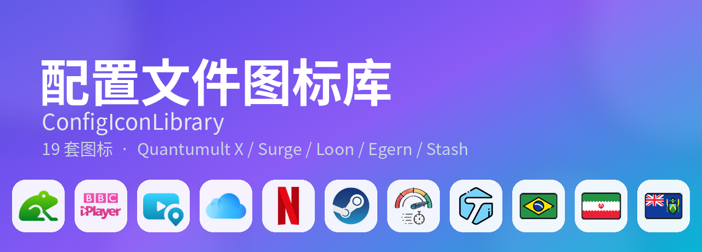

A collection of profile icon subscriptions for proxy apps (Quantumult X, Surge, Loon, Egern, Stash, etc.). Click an icon set name below — it is the subscription link. Copy it and paste it into your proxy app's icon subscription, and you can apply a matching icon set to your profiles, subscriptions, and policy groups.

## 📖 Usage Guide

In short: this is a profile icon subscription library that lets you give the profiles, subscriptions, and policy groups in your proxy app a nicer look.

### What is this

This library holds 19 profile icon sets, with all icon files in the root of this repository. Click any icon set name in the "Icon List" below — the name itself is the subscription link. Note: these icons are for profiles, subscriptions, and policy groups, not for proxy nodes.

### What you need

- An iPhone, iPad, or Mac with one of these proxy apps installed: Quantumult X, Loon, Surge, Egern, or Stash.
- Network access to GitHub — subscription links are served from `raw.githubusercontent.com`.

### How to use

1. Pick an icon set you like in the "Icon List" below, click its name, and copy the link.
2. Open your proxy app, paste the link in the icon subscription (icon library) section to add the subscription, and wait for the app to fetch the icons.
3. Open a profile (or long-press it), pick an icon from your subscribed icon libraries in the icon field, and save.
4. Subscriptions and policy groups work the same way: pick from the icon library in their icon settings.

See the "[Tutorial](#tutorial)" section below for the exact entry points in each app and the `img-url` format.

### FAQ

- **Icons don't show up after subscribing?** First check that you copied the full link, then manually refresh the icon subscription in the app. If `raw.githubusercontent.com` is unreachable from your network, the subscription will fail.
- **Want just one icon instead of the whole set?** You can — use that single icon's direct PNG link after `img-url=`. See "Direct Link for a Single Icon (img-url)" in the Tutorial.
- **Are these node icons?** No. The icons in this library are for profiles, subscriptions, and policy groups. For node icons, look for a node icon library.
- **Are there newer versions of the icons?** The icons come from each author's original repository; this library only collects the subscriptions. To check the latest version of a set, follow the original link in the "Icon List".

## 📊 Statistics

## 🛠️ Tech Stack

## 😄 Daily Sentence

## 🎮 Contribution Graph

<picture>
  <source media="(prefers-color-scheme: dark)" srcset="https://contrib-rotate.lzr52o.workers.dev/rotate?theme=dark" />
  <source media="(prefers-color-scheme: light)" srcset="https://contrib-rotate.lzr52o.workers.dev/rotate?theme=light" />
  
</picture>

## All Icons at a Glance

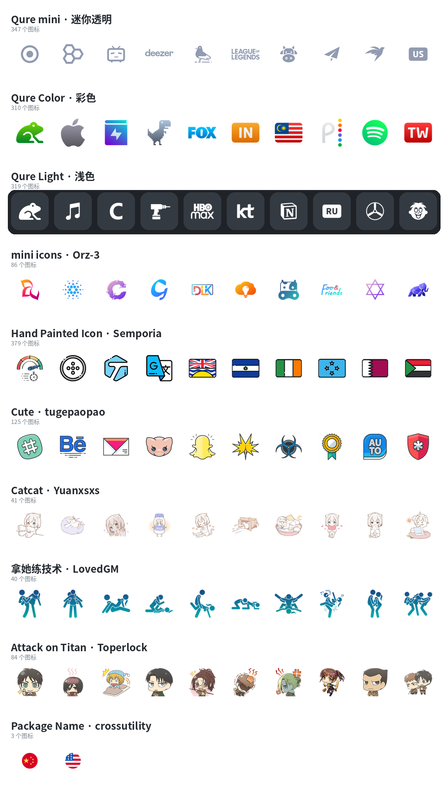

## Icon List

### Qure Series (Author: Koolson)

| Icon Set | Style / Description | Icon Count |
|---|---|---|
| [Qure mini](https://raw.githubusercontent.com/lzr52o/ConfigIconLibrary/master/Quremini.json) | Mini transparent theme, ideal for subscription icons | 347 |
| [Qure Color（全部）](https://raw.githubusercontent.com/lzr52o/ConfigIconLibrary/master/QureColor-All.json) | Color theme · All icons | 310 |
| [Qure Color（默认）](https://raw.githubusercontent.com/lzr52o/ConfigIconLibrary/master/QureColor-Default.json) | Color theme · Default | 15 |
| [Qure Color（常用）](https://raw.githubusercontent.com/lzr52o/ConfigIconLibrary/master/QureColor-Common.json) | Color theme · Commonly used | 12 |
| [Qure Color（应用与游戏）](https://raw.githubusercontent.com/lzr52o/ConfigIconLibrary/master/QureColor-AppGame.json) | Color theme · Apps & Games | 41 |
| [Qure Color（服务）](https://raw.githubusercontent.com/lzr52o/ConfigIconLibrary/master/QureColor-Service.json) | Color theme · Services | 16 |
| [Qure Color（其它）](https://raw.githubusercontent.com/lzr52o/ConfigIconLibrary/master/QureColor-Other.json) | Color theme · Others | 47 |
| [Qure Color（地区）](https://raw.githubusercontent.com/lzr52o/ConfigIconLibrary/master/QureColor-Area.json) | Color theme · Regions | 56 |
| [Qure Color（流媒体）](https://raw.githubusercontent.com/lzr52o/ConfigIconLibrary/master/QureColor-Media.json) | Color theme · Streaming media | 99 |
| [Qure Color（服务器）](https://raw.githubusercontent.com/lzr52o/ConfigIconLibrary/master/QureColor-Server.json) | Color theme · Servers | 9 |
| [Qure Color（禁止）](https://raw.githubusercontent.com/lzr52o/ConfigIconLibrary/master/QureColor-Inhibition.json) | Color theme · Prohibited | 4 |
| [Qure Light（全部）](https://raw.githubusercontent.com/lzr52o/ConfigIconLibrary/master/QureLight-All.json) | Light theme · All icons | 319 |

Original source:[Koolson/Qure](https://github.com/Koolson/Qure)

**Qure Preview**

| | |
|---|---|
| 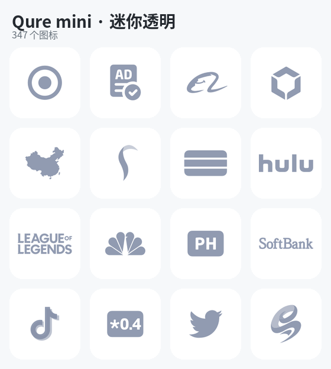 | 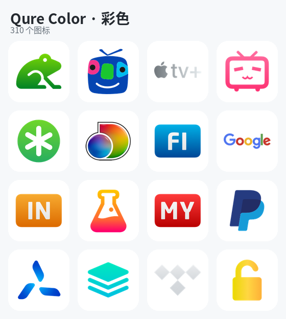 |
| 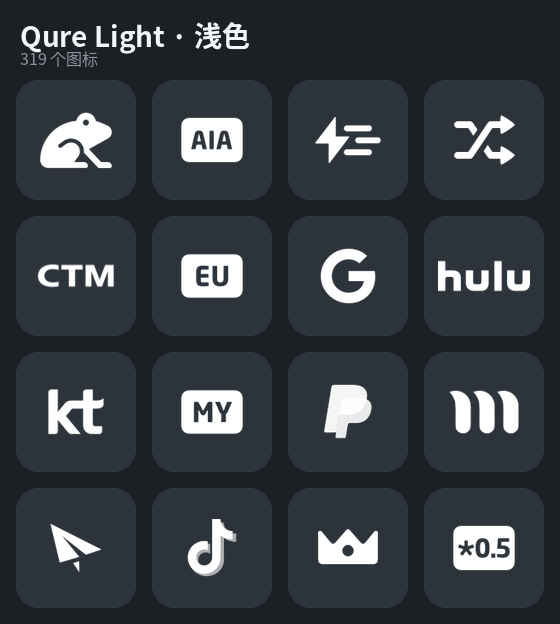 | |

### Other Authors

| Icon Set | Author | Style / Description | Icon Count |
|---|---|---|---|
| [mini icons](https://raw.githubusercontent.com/lzr52o/ConfigIconLibrary/master/mini.json) | Orz-3 | Mini icons, including airport subscriptions, Task, region, and policy group icons | 86 |
| [Hand Painted Icon](https://raw.githubusercontent.com/lzr52o/ConfigIconLibrary/master/Semporia.json) | Semporia | Hand-painted style | 379 |
| [Cute](https://raw.githubusercontent.com/lzr52o/ConfigIconLibrary/master/Cute.json) | tugepaopao | Cute style, updated regularly | 125 |
| [Catcat](https://raw.githubusercontent.com/lzr52o/ConfigIconLibrary/master/Catcat.json) | Yuanxsxs | Cat theme | 41 |
| [拿她练技术](https://raw.githubusercontent.com/lzr52o/ConfigIconLibrary/master/zishi-cs.json) | LovedGM | Practice work | 40 |
| [Attack on Titan](https://raw.githubusercontent.com/lzr52o/ConfigIconLibrary/master/AOT-icons.json) | Toperlock | Attack on Titan theme | 84 |
| [Package Name](https://raw.githubusercontent.com/lzr52o/ConfigIconLibrary/master/icon-gallery.json) | crossutility | Example (only 3 icons) | 3 |

Original source:
- [Orz-3/mini](https://raw.githubusercontent.com/Orz-3/mini/master/mini.json)
- [Semporia/Hand-Painted-icon](https://raw.githubusercontent.com/Semporia/Hand-Painted-icon/master/Semporia.json)
- [tugepaopao/Image-Storage](https://raw.githubusercontent.com/tugepaopao/Image-Storage/master/other/Cute.json)
- [Yuanxsxs/QtumultX](https://raw.githubusercontent.com/Yuanxsxs/QtumultX/master/Icon/Catcat.json)
- [LovedGM/Quantumult-X-TuBiao](https://raw.githubusercontent.com/LovedGM/Quantumult-X-TuBiao/main/zishi-cs.json)
- [Toperlock/Quantumult](https://raw.githubusercontent.com/Toperlock/Quantumult/main/AOT-icons.json)
- [crossutility/Quantumult-X](https://raw.githubusercontent.com/crossutility/Quantumult-X/master/icon-gallery.json)

**Other Authors' Preview**

| | |
|---|---|
| 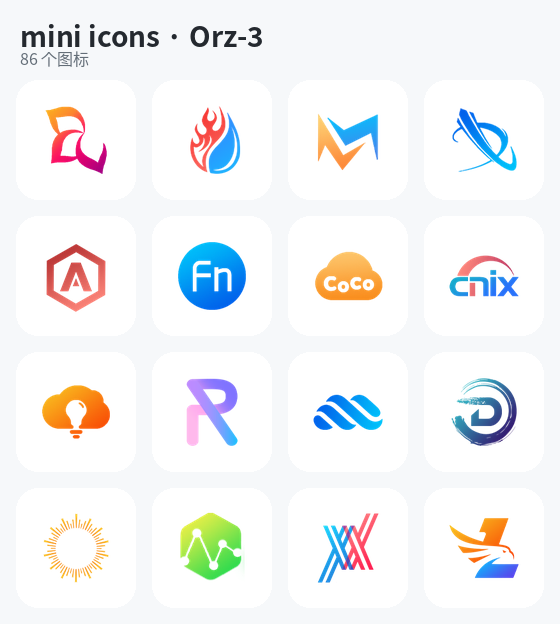 | 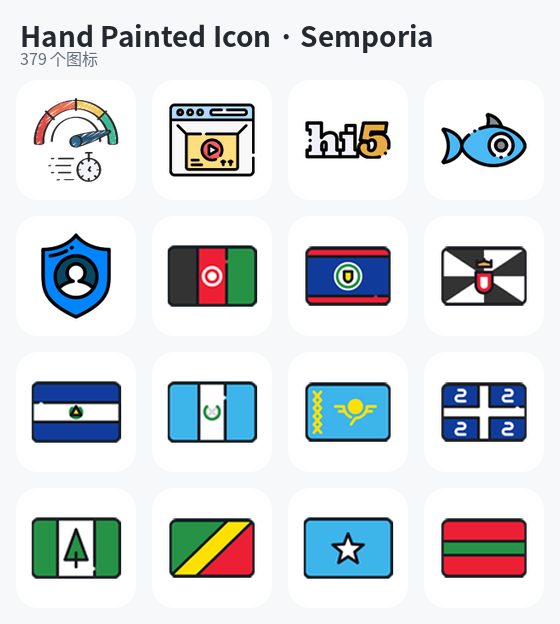 |
| 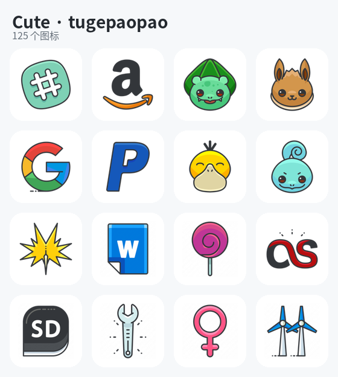 | 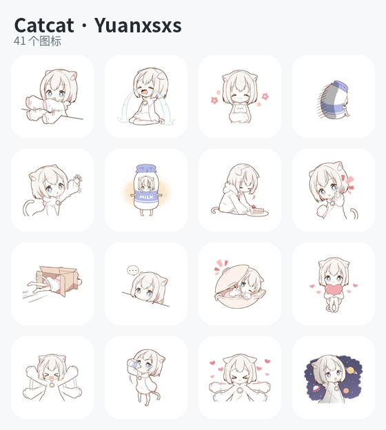 |
| 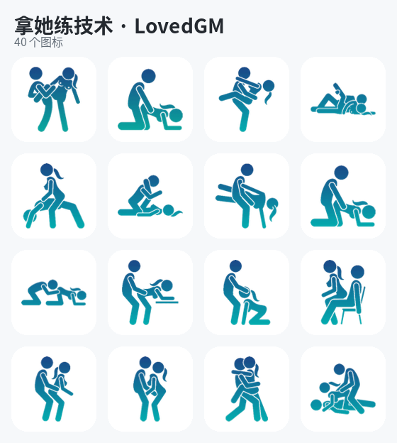 | 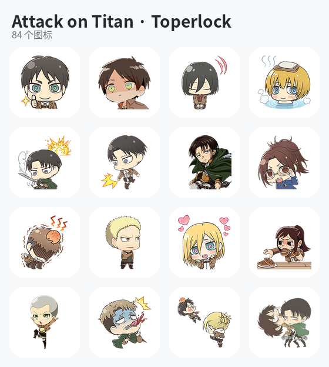 |
| 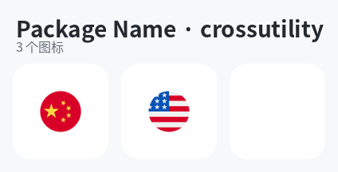 | |

## Tutorial

### Step 1: Subscribe to an Icon Library

Click the name of the icon set you want and copy the link (the name itself is the subscription link), then add it in your proxy app's icon subscription (icon library). The app will fetch the whole set, and you can pick icons from it whenever you change an icon.

- Quantumult X: add the subscription link under icon subscriptions.
- Loon: add the subscription link under icon subscriptions.
- Surge / Egern / Stash: add the subscription link under icon subscriptions or the icon library entry (the entry point differs slightly by app, but it is usually on a settings or profile-related page).

### Changing a Profile's Icon

After subscribing to an icon library, open a profile in the app (or long-press it), pick an icon from your subscribed libraries in the icon field, and save. The entry point differs slightly by app, but it is usually in the profile's settings or long-press menu.

### Changing Subscription and Policy Group Icons

#### Quantumult X

**Subscription icons (text editing):** open the profile editor, find `[server_remote]`, and on the subscription line you want to add an icon to, insert `img-url=<icon URL>` before `enabled=true`, separated by English commas with a space after each comma.

Full example: `https://example.com/sub.txt, tag=<subscription name>, img-url=https://raw.githubusercontent.com/Koolson/Qure/master/IconSet/mini/Direct.png, enabled=true`

**Policy group icons:**
- UI: long-press the policy group you want to change, choose Edit, and enter the icon URL in the icon field.
- Text editing: open the profile editor, find `[policy]`, and in the policy section you want to change, insert `img-url=<icon URL>` before `enabled=true`, separated by English commas with a space after each comma.

#### Loon

**UI:** tap the "Policy" tab at the bottom, long-press the subscription or policy group you want to change, and enter the icon URL in the icon field.

**Text editing:** open the Config tab, tap Edit → Text Edit, find `[Remote Proxy]` / `[Proxy Group]`, and add `img-url=<icon URL>` to the section you want to change, separated from the previous part by an English comma.

#### Surge / Egern / Stash

After adding this library's link under icon subscriptions, pick icons from the library in the icon settings of a profile, subscription, or policy group. The exact entry point depends on each app's current version.

### Direct Link for a Single Icon (img-url)

If you only want a single icon, you don't need to subscribe to the whole set — just use the icon's direct PNG link after `img-url=`. Icon PNG URLs are usually in the original author's repository, built from the icon name; for example, Qure icons live under `https://raw.githubusercontent.com/Koolson/Qure/master/Other/`. Remember to replace `name.png` with the actual file name.

## Disclaimer

1. The icons and LOGOs in this library are shared for resource sharing and learning purposes only. Their legality, legitimacy, and accuracy are not guaranteed; do not use this library for any commercial purpose or profit;
2. Following the safe harbor principle, if any image or content infringes on copyright, please contact the Telegram private chat bot [@ccccccccoBot](https://t.me/ccccccccoBot) to report it. It will be removed after verification. All copyrights belong to the original authors and their websites;
3. I take no responsibility for any content, including but not limited to any loss or damage caused by any errors in the content;
4. Anyone who visits this website by any means, or directly or indirectly uses any resource from this library, should read this statement carefully. Once you use or repost any tutorial or resource from this library, you are deemed to have accepted this disclaimer.
5. If you repost, please credit the source. Thank you!

## Notes

- 19 sets of profile icons in total, all files are in this repository's root directory.
- The icon files come from each author's original repository, and copyright belongs to the original authors; this library only collects them for subscription.
- The original `zishi-cs.json` had an extra trailing comma (invalid JSON), which has been fixed here; the icon content is unchanged.

