[English](README_EN.md) · [简体中文](README.md) · 日本語 · [한국어](README_KO.md) · [Türkçe](README_TR.md)

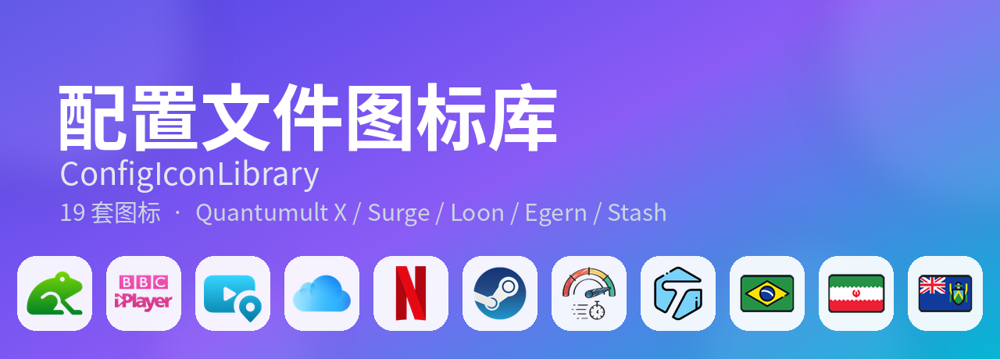

プロキシソフト（Quantumult X、Surge、Loon、Egern、Stash など）向けの設定ファイルアイコン購読コレクションです。下のアイコンセット名をクリックすると購読リンクになります。コピーしてプロキシソフトのアイコン購読に追加すれば、設定ファイル・サブスクリプション・ポリシーグループに対応するアイコンセットを適用できます。

## 📊 統計情報

## 🛠️ 技術スタック

## 😄 今日の一言

## 🎮 コントリビューショングラフ

<picture>
  <source media="(prefers-color-scheme: dark)" srcset="https://contrib-rotate.lzr52o.workers.dev/rotate?theme=dark" />
  <source media="(prefers-color-scheme: light)" srcset="https://contrib-rotate.lzr52o.workers.dev/rotate?theme=light" />
  
</picture>

## アイコン一覧

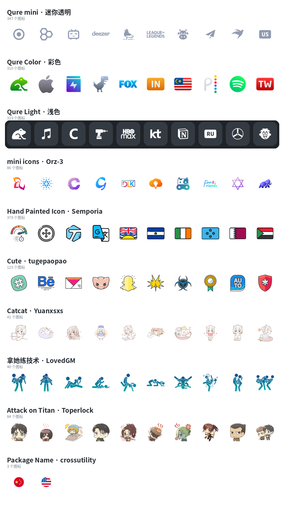

## アイコンリスト

### Qure シリーズ（作者：Koolson）

| アイコンセット | スタイル / 説明 | アイコン数 |
|---|---|---|
| [Qure mini](https://raw.githubusercontent.com/lzr52o/ConfigIconLibrary/master/Quremini.json) | ミニ透明テーマ、サブスクリプションアイコンに最適 | 347 |
| [Qure Color（全部）](https://raw.githubusercontent.com/lzr52o/ConfigIconLibrary/master/QureColor-All.json) | カラーテーマ · すべてのアイコン | 310 |
| [Qure Color（默认）](https://raw.githubusercontent.com/lzr52o/ConfigIconLibrary/master/QureColor-Default.json) | カラーテーマ · デフォルト | 15 |
| [Qure Color（常用）](https://raw.githubusercontent.com/lzr52o/ConfigIconLibrary/master/QureColor-Common.json) | カラーテーマ · よく使うもの | 12 |
| [Qure Color（应用与游戏）](https://raw.githubusercontent.com/lzr52o/ConfigIconLibrary/master/QureColor-AppGame.json) | カラーテーマ · アプリとゲーム | 41 |
| [Qure Color（服务）](https://raw.githubusercontent.com/lzr52o/ConfigIconLibrary/master/QureColor-Service.json) | カラーテーマ · サービス | 16 |
| [Qure Color（其它）](https://raw.githubusercontent.com/lzr52o/ConfigIconLibrary/master/QureColor-Other.json) | カラーテーマ · その他 | 47 |
| [Qure Color（地区）](https://raw.githubusercontent.com/lzr52o/ConfigIconLibrary/master/QureColor-Area.json) | カラーテーマ · 地域 | 56 |
| [Qure Color（流媒体）](https://raw.githubusercontent.com/lzr52o/ConfigIconLibrary/master/QureColor-Media.json) | カラーテーマ · ストリーミングメディア | 99 |
| [Qure Color（服务器）](https://raw.githubusercontent.com/lzr52o/ConfigIconLibrary/master/QureColor-Server.json) | カラーテーマ · サーバー | 9 |
| [Qure Color（禁止）](https://raw.githubusercontent.com/lzr52o/ConfigIconLibrary/master/QureColor-Inhibition.json) | カラーテーマ · 禁止 | 4 |
| [Qure Light（全部）](https://raw.githubusercontent.com/lzr52o/ConfigIconLibrary/master/QureLight-All.json) | ライトテーマ · すべてのアイコン | 319 |

元のアドレス：[Koolson/Qure](https://github.com/Koolson/Qure)

**Qure プレビュー**

| | |
|---|---|
| 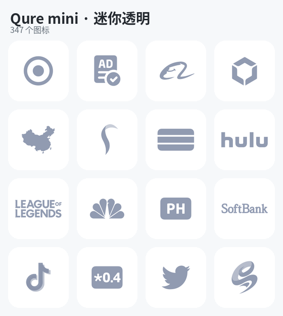 | 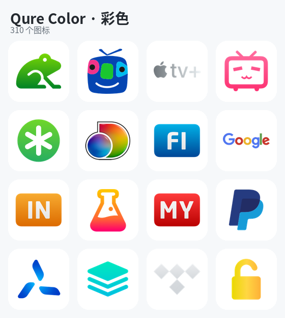 |
| 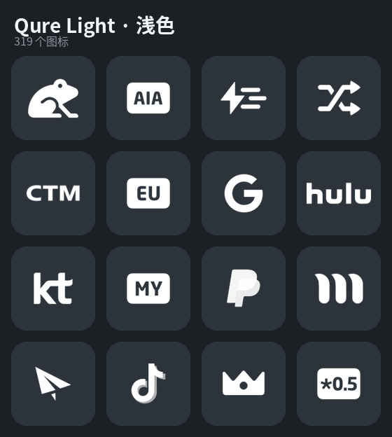 | |

### その他の作者

| アイコンセット | 作者 | スタイル / 説明 | アイコン数 |
|---|---|---|---|
| [mini icons](https://raw.githubusercontent.com/lzr52o/ConfigIconLibrary/master/mini.json) | Orz-3 | ミニアイコン。空港サブスクリプション、Task、地域、ポリシーグループのアイコンを含む | 86 |
| [Hand Painted Icon](https://raw.githubusercontent.com/lzr52o/ConfigIconLibrary/master/Semporia.json) | Semporia | 手描き風 | 379 |
| [Cute](https://raw.githubusercontent.com/lzr52o/ConfigIconLibrary/master/Cute.json) | tugepaopao | かわいい系、随時更新中 | 125 |
| [Catcat](https://raw.githubusercontent.com/lzr52o/ConfigIconLibrary/master/Catcat.json) | Yuanxsxs | 猫テーマ | 41 |
| [拿她练技术](https://raw.githubusercontent.com/lzr52o/ConfigIconLibrary/master/zishi-cs.json) | LovedGM | 練習作品 | 40 |
| [Attack on Titan](https://raw.githubusercontent.com/lzr52o/ConfigIconLibrary/master/AOT-icons.json) | Toperlock | 進撃の巨人テーマ | 84 |
| [Package Name](https://raw.githubusercontent.com/lzr52o/ConfigIconLibrary/master/icon-gallery.json) | crossutility | サンプル（アイコンは 3 個のみ） | 3 |

元のアドレス：
- [Orz-3/mini](https://raw.githubusercontent.com/Orz-3/mini/master/mini.json)
- [Semporia/Hand-Painted-icon](https://raw.githubusercontent.com/Semporia/Hand-Painted-icon/master/Semporia.json)
- [tugepaopao/Image-Storage](https://raw.githubusercontent.com/tugepaopao/Image-Storage/master/other/Cute.json)
- [Yuanxsxs/QtumultX](https://raw.githubusercontent.com/Yuanxsxs/QtumultX/master/Icon/Catcat.json)
- [LovedGM/Quantumult-X-TuBiao](https://raw.githubusercontent.com/LovedGM/Quantumult-X-TuBiao/main/zishi-cs.json)
- [Toperlock/Quantumult](https://raw.githubusercontent.com/Toperlock/Quantumult/main/AOT-icons.json)
- [crossutility/Quantumult-X](https://raw.githubusercontent.com/crossutility/Quantumult-X/master/icon-gallery.json)

**その他の作者のプレビュー**

| | |
|---|---|
| 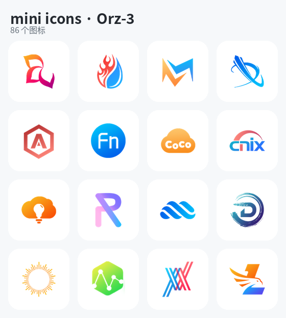 | 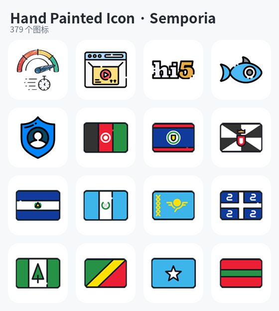 |
| 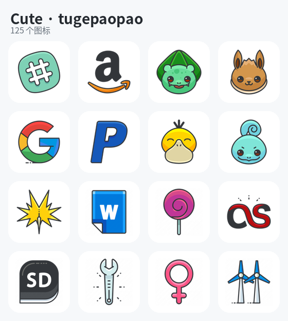 | 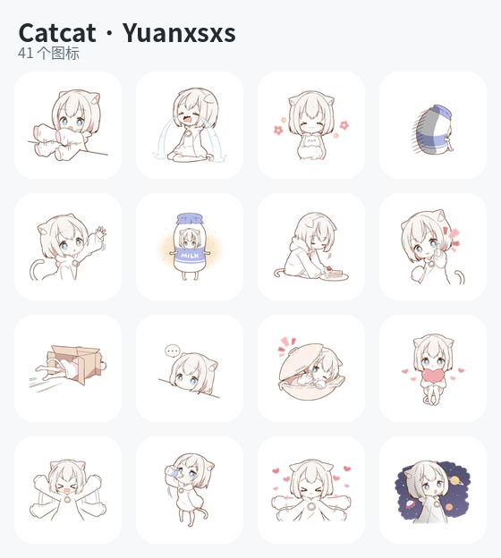 |
| 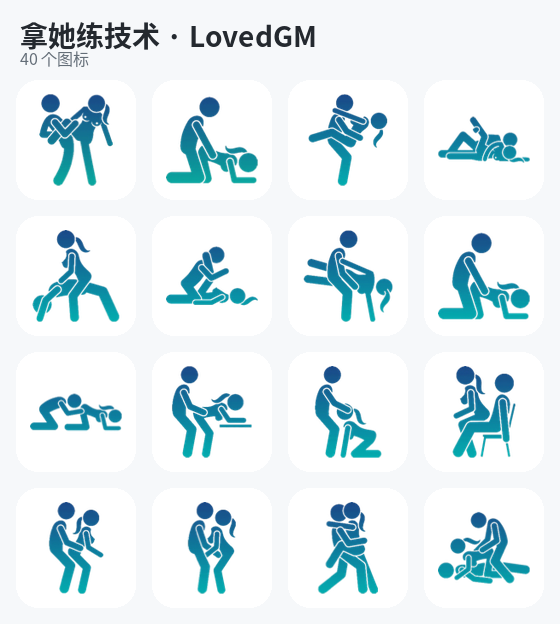 | 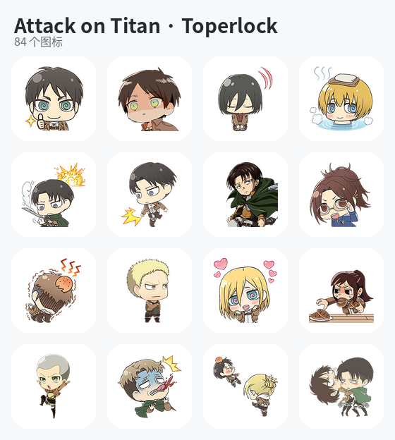 |
| 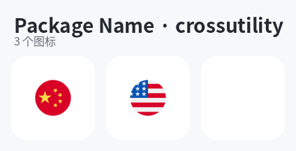 | |

## 使い方

### ステップ 1：アイコンライブラリを購読する

使いたいアイコンセットの名前をクリックしてリンクをコピーし（名前自体が購読リンクです）、プロキシソフトのアイコン購読（アイコンライブラリ）に追加してください。アプリがアイコンセット全体を取得するので、あとはアイコンを変更するときにそこから選ぶだけです。

- Quantumult X：アイコン購読から購読リンクを追加します。
- Loon：アイコン購読から購読リンクを追加します。
- Surge / Egern / Stash：アイコン購読またはアイコンライブラリの入口から購読リンクを追加します（入口の場所はアプリによって多少異なりますが、通常は設定または設定ファイル関連のページにあります）。

### 設定ファイルのアイコンを変更する

アイコンライブラリを購読したら、アプリで設定ファイルを開き（または長押しし）、アイコン欄で購読済みのアイコンライブラリから 1 つ選んで保存します。入口はアプリによって多少異なりますが、通常は設定ファイルの設定画面または長押しメニューにあります。

### サブスクリプションとポリシーグループのアイコンを変更する

#### Quantumult X

**サブスクリプションアイコン（テキスト編集）：**設定ファイルの編集画面を開き、`[server_remote]` を探して、アイコンを付けたいサブスクリプションの行の `enabled=true` の前に `img-url=<アイコン URL>` を追加します。前後は半角カンマで区切り、カンマの後には半角スペースを 1 つ入れます。

完全な例：`https://example.com/sub.txt, tag=<サブスクリプション名>, img-url=https://raw.githubusercontent.com/Koolson/Qure/master/IconSet/mini/Direct.png, enabled=true`

**ポリシーグループアイコン：**
- 画面操作：アイコンを変更したいポリシーグループを長押しして編集を選び、アイコン欄にアイコン URL を入力します。
- テキスト編集：設定ファイルの編集画面を開き、`[policy]` を探して、変更したいポリシーの段落の `enabled=true` の前に `img-url=<アイコン URL>` を追加します。前後は半角カンマで区切り、カンマの後には半角スペースを 1 つ入れます。

#### Loon

**画面操作：**下部の「策略」（ポリシー）タブをタップし、アイコンを変更したいサブスクリプションまたはポリシーグループを長押しして、アイコン欄にアイコン URL を入力します。

**テキスト編集：**設定タブを開き、編集 → テキスト編集をタップして、`[Remote Proxy]` / `[Proxy Group]` を探し、変更したい段落に `img-url=<アイコン URL>` を追加します。前の部分とは半角カンマで区切ります。

#### Surge / Egern / Stash

アイコン購読に本ライブラリのリンクを追加したら、設定ファイル・サブスクリプション・ポリシーグループのアイコン設定でライブラリから選ぶだけです。具体的な入口は各アプリの現行バージョンによって異なります。

### 単一アイコンの直リンク（img-url）

1 つのアイコンだけ使いたい場合は、セット全体を購読する必要はありません。アイコンの PNG 直リンクを `img-url=` の後に入力するだけです。アイコンの PNG アドレスは通常、原作者のリポジトリにあり、アイコン名から組み立てます。たとえば Qure のアイコンは `https://raw.githubusercontent.com/Koolson/Qure/master/Other/` ディレクトリにあります。`name.png` は実際のファイル名に置き換えてください。

## 免責事項

1. 本ライブラリ内のアイコン・LOGO は、リソース共有および学習参考のみを目的としており、その合法性・正当性・正確性を保証しません。本ライブラリをいかなる商業目的や営利にも使用しないでください。
2. セーフハーバーの原則に従い、画像やコンテンツに著作権侵害がある場合は、Telegram のプライベートチャットボット [@ccccccccoBot](https://t.me/ccccccccoBot) までご連絡ください。確認後に削除します。著作権はすべて原作者およびそのウェブサイトに帰属します。
3. 私は、いかなるコンテンツについても責任を負いません。これには、コンテンツの誤りに起因するいかなる損失や損害も含まれますが、これに限定されません。
4. いかなる方法で本サイトにアクセスする方、または本ライブラリの関連リソースを直接・間接に利用する方は、本声明をよくお読みください。本ライブラリのチュートリアルやリソースを使用・転載した時点で、本免責事項に同意したものとみなします。
5. 転載の際は出典を明記してください。ありがとうございます！

## 説明

- 設定ファイルアイコンは全 19 セットで、ファイルはすべて本リポジトリのルートディレクトリにあります。
- アイコンファイルは各作者の元のリポジトリのもので、著作権は原作者に帰属します。本ライブラリは購読用に集めたものです。
- `zishi-cs.json` の元ファイルには末尾に余分なカンマがありました（JSON として不正）。こちらでは修正済みです。アイコンの内容は変わっていません。

