[English](README_EN.md) · [简体中文](README.md) · [日本語](README_JA.md) · 한국어 · [Türkçe](README_TR.md)

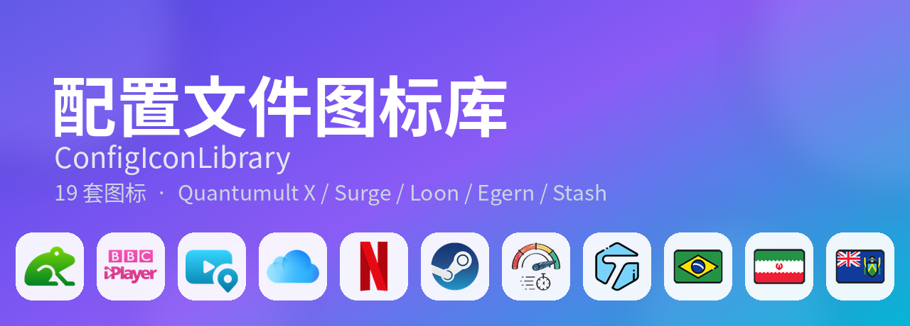

프록시 앱(Quantumult X, Surge, Loon, Egern, Stash 등)용 프로필 아이콘 구독 모음입니다. 아래 아이콘 세트 이름을 클릭하면 구독 링크입니다. 복사해서 프록시 앱의 아이콘 구독에 추가하면 프로필, 구독, 정책 그룹에 해당 아이콘 세트를 적용할 수 있습니다.

## 📊 통계

## 🛠️ 기술 스택

## 😄 오늘의 한마디

## 🎮 기여 그래프

<picture>
  <source media="(prefers-color-scheme: dark)" srcset="https://contrib-rotate.lzr52o.workers.dev/rotate?theme=dark" />
  <source media="(prefers-color-scheme: light)" srcset="https://contrib-rotate.lzr52o.workers.dev/rotate?theme=light" />
  
</picture>

## 전체 아이콘 한눈에 보기

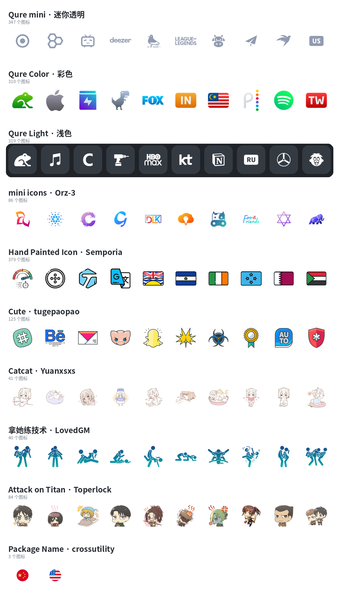

## 아이콘 목록

### Qure 시리즈 (제작자: Koolson)

| 아이콘 세트 | 스타일 / 설명 | 아이콘 수 |
|---|---|---|
| [Qure mini](https://raw.githubusercontent.com/lzr52o/ConfigIconLibrary/master/Quremini.json) | 미니 투명 테마, 구독 아이콘으로 적합 | 347 |
| [Qure Color（全部）](https://raw.githubusercontent.com/lzr52o/ConfigIconLibrary/master/QureColor-All.json) | 컬러 테마 · 모든 아이콘 | 310 |
| [Qure Color（默认）](https://raw.githubusercontent.com/lzr52o/ConfigIconLibrary/master/QureColor-Default.json) | 컬러 테마 · 기본 | 15 |
| [Qure Color（常用）](https://raw.githubusercontent.com/lzr52o/ConfigIconLibrary/master/QureColor-Common.json) | 컬러 테마 · 자주 쓰는 아이콘 | 12 |
| [Qure Color（应用与游戏）](https://raw.githubusercontent.com/lzr52o/ConfigIconLibrary/master/QureColor-AppGame.json) | 컬러 테마 · 앱 및 게임 | 41 |
| [Qure Color（服务）](https://raw.githubusercontent.com/lzr52o/ConfigIconLibrary/master/QureColor-Service.json) | 컬러 테마 · 서비스 | 16 |
| [Qure Color（其它）](https://raw.githubusercontent.com/lzr52o/ConfigIconLibrary/master/QureColor-Other.json) | 컬러 테마 · 기타 | 47 |
| [Qure Color（地区）](https://raw.githubusercontent.com/lzr52o/ConfigIconLibrary/master/QureColor-Area.json) | 컬러 테마 · 지역 | 56 |
| [Qure Color（流媒体）](https://raw.githubusercontent.com/lzr52o/ConfigIconLibrary/master/QureColor-Media.json) | 컬러 테마 · 스트리밍 미디어 | 99 |
| [Qure Color（服务器）](https://raw.githubusercontent.com/lzr52o/ConfigIconLibrary/master/QureColor-Server.json) | 컬러 테마 · 서버 | 9 |
| [Qure Color（禁止）](https://raw.githubusercontent.com/lzr52o/ConfigIconLibrary/master/QureColor-Inhibition.json) | 컬러 테마 · 금지 | 4 |
| [Qure Light（全部）](https://raw.githubusercontent.com/lzr52o/ConfigIconLibrary/master/QureLight-All.json) | 라이트 테마 · 모든 아이콘 | 319 |

원본 주소:[Koolson/Qure](https://github.com/Koolson/Qure)

**Qure 미리 보기**

| | |
|---|---|
| 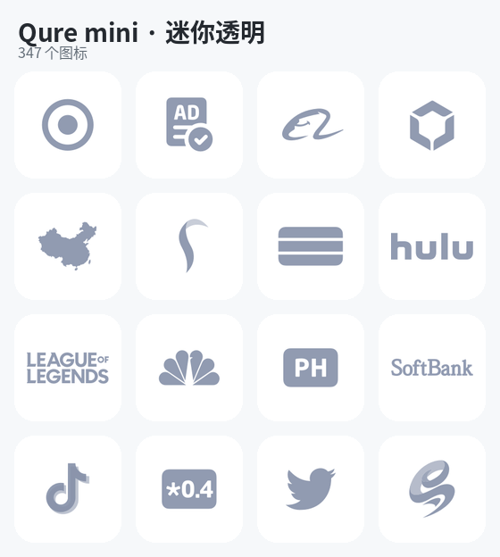 | 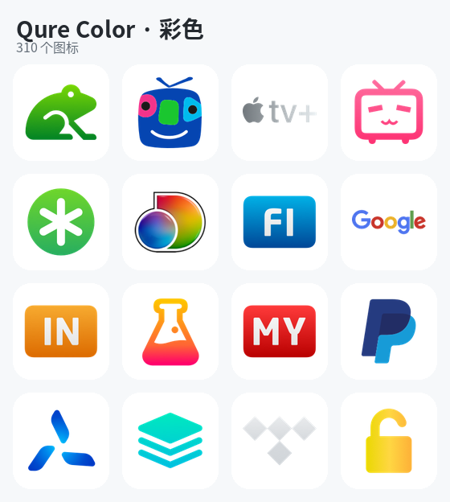 |
| 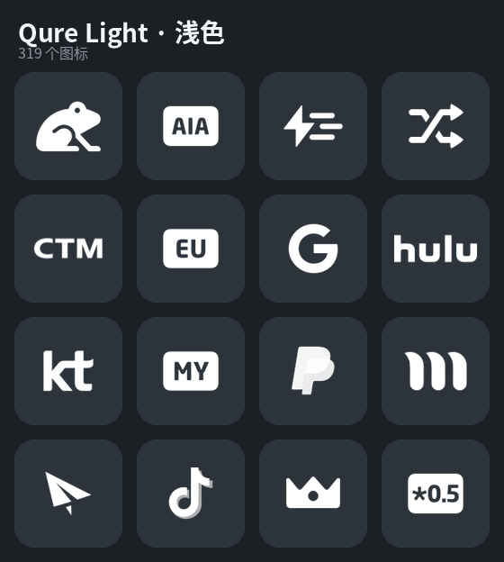 | |

### 기타 제작자

| 아이콘 세트 | 제작자 | 스타일 / 설명 | 아이콘 수 |
|---|---|---|---|
| [mini icons](https://raw.githubusercontent.com/lzr52o/ConfigIconLibrary/master/mini.json) | Orz-3 | 미니 아이콘. 공항 구독, Task, 지역, 정책 그룹 아이콘 포함 | 86 |
| [Hand Painted Icon](https://raw.githubusercontent.com/lzr52o/ConfigIconLibrary/master/Semporia.json) | Semporia | 손그림 스타일 | 379 |
| [Cute](https://raw.githubusercontent.com/lzr52o/ConfigIconLibrary/master/Cute.json) | tugepaopao | 귀여운 스타일, 계속 업데이트 중 | 125 |
| [Catcat](https://raw.githubusercontent.com/lzr52o/ConfigIconLibrary/master/Catcat.json) | Yuanxsxs | 고양이 테마 | 41 |
| [拿她练技术](https://raw.githubusercontent.com/lzr52o/ConfigIconLibrary/master/zishi-cs.json) | LovedGM | 연습 작품 | 40 |
| [Attack on Titan](https://raw.githubusercontent.com/lzr52o/ConfigIconLibrary/master/AOT-icons.json) | Toperlock | 진격의 거인 테마 | 84 |
| [Package Name](https://raw.githubusercontent.com/lzr52o/ConfigIconLibrary/master/icon-gallery.json) | crossutility | 예시(아이콘 3개만 있음) | 3 |

원본 주소:
- [Orz-3/mini](https://raw.githubusercontent.com/Orz-3/mini/master/mini.json)
- [Semporia/Hand-Painted-icon](https://raw.githubusercontent.com/Semporia/Hand-Painted-icon/master/Semporia.json)
- [tugepaopao/Image-Storage](https://raw.githubusercontent.com/tugepaopao/Image-Storage/master/other/Cute.json)
- [Yuanxsxs/QtumultX](https://raw.githubusercontent.com/Yuanxsxs/QtumultX/master/Icon/Catcat.json)
- [LovedGM/Quantumult-X-TuBiao](https://raw.githubusercontent.com/LovedGM/Quantumult-X-TuBiao/main/zishi-cs.json)
- [Toperlock/Quantumult](https://raw.githubusercontent.com/Toperlock/Quantumult/main/AOT-icons.json)
- [crossutility/Quantumult-X](https://raw.githubusercontent.com/crossutility/Quantumult-X/master/icon-gallery.json)

**기타 제작자 미리 보기**

| | |
|---|---|
| 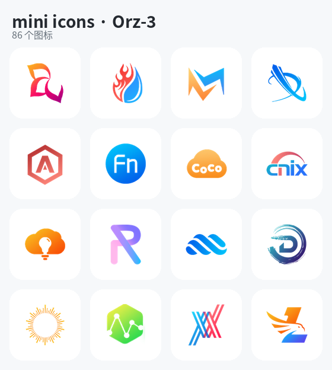 | 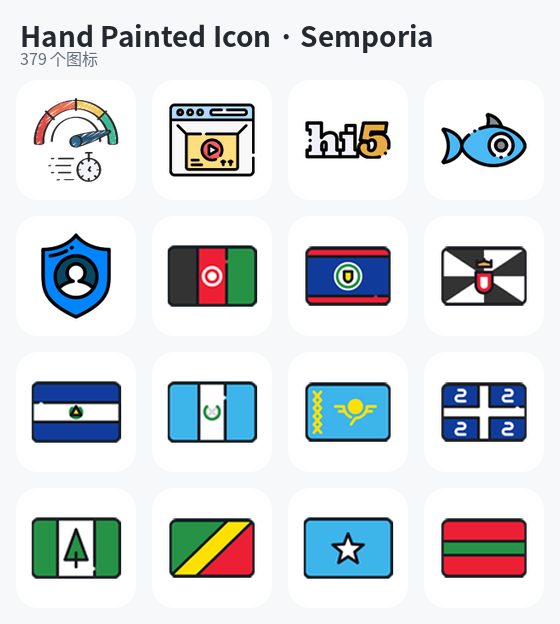 |
| 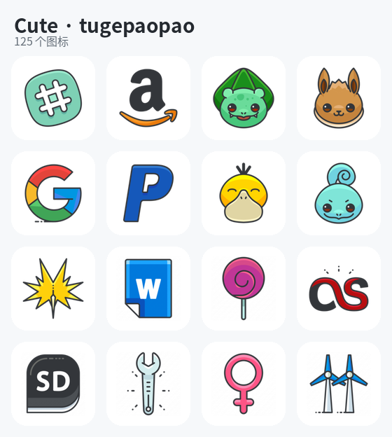 | 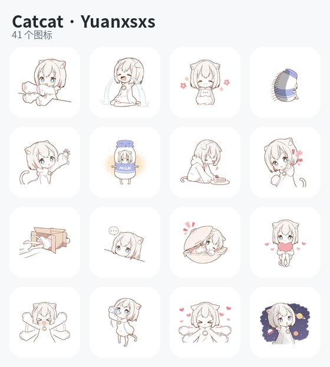 |
| 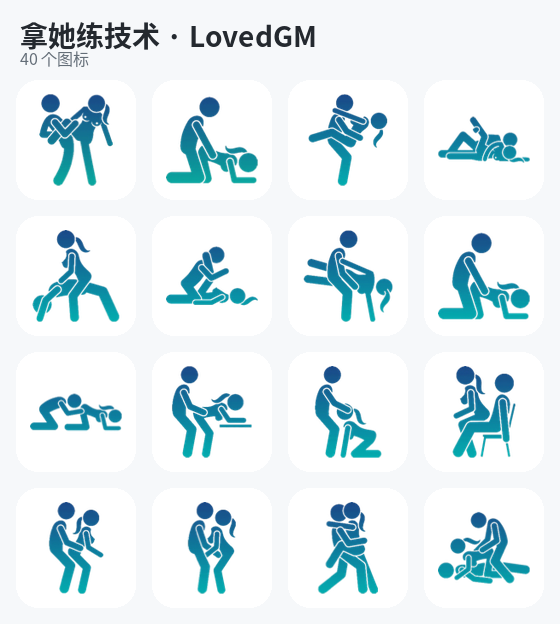 | 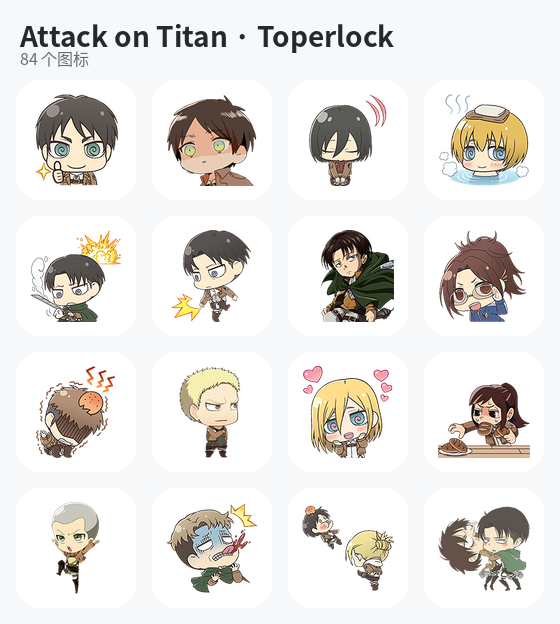 |
| 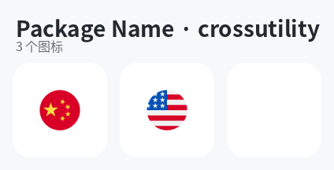 | |

## 사용 방법

### 1단계: 아이콘 라이브러리 구독하기

원하는 아이콘 세트 이름을 클릭해 링크를 복사하고(이름 자체가 구독 링크입니다), 프록시 앱의 아이콘 구독(아이콘 라이브러리)에 추가하세요. 앱이 전체 세트를 가져오고, 이후 아이콘을 바꿀 때 그 안에서 바로 고를 수 있습니다.

- Quantumult X: 아이콘 구독에 구독 링크를 추가하세요.
- Loon: 아이콘 구독에 구독 링크를 추가하세요.
- Surge / Egern / Stash: 아이콘 구독 또는 아이콘 라이브러리 입구에서 구독 링크를 추가하세요(입구 위치는 앱마다 조금씩 다르지만, 보통 설정 또는 프로필 관련 페이지에 있습니다).

### 프로필 아이콘 변경하기

아이콘 라이브러리를 구독한 뒤 앱에서 프로필을 열고(또는 길게 누르고), 아이콘 항목에서 구독한 아이콘 라이브러리 중 하나를 골라 저장하세요. 입구는 앱마다 조금씩 다르지만, 보통 프로필 설정이나 길게 누르기 메뉴에 있습니다.

### 구독 및 정책 그룹 아이콘 변경하기

#### Quantumult X

**구독 아이콘(텍스트 편집):** 프로필 편집을 열고 `[server_remote]`를 찾은 뒤, 아이콘을 추가할 구독 행의 `enabled=true` 앞에 `img-url=<아이콘 URL>`을 추가하세요. 앞뒤는 영문 쉼표로 구분하고 쉼표 뒤에 공백을 한 칸 넣으세요.

전체 예시: `https://example.com/sub.txt, tag=<구독 이름>, img-url=https://raw.githubusercontent.com/Koolson/Qure/master/IconSet/mini/Direct.png, enabled=true`

**정책 그룹 아이콘:**
- 화면 조작: 아이콘을 바꿀 정책 그룹을 길게 누르고 편집을 선택한 뒤 아이콘 항목에 아이콘 URL을 입력하세요.
- 텍스트 편집: 프로필 편집을 열고 `[policy]`를 찾은 뒤, 바꿀 정책 단락의 `enabled=true` 앞에 `img-url=<아이콘 URL>`을 추가하세요. 앞뒤는 영문 쉼표로 구분하고 쉼표 뒤에 공백을 한 칸 넣으세요.

#### Loon

**화면 조작:** 하단의 「정책」 탭을 누르고 아이콘을 바꿀 구독 또는 정책 그룹을 길게 눌러 아이콘 항목에 아이콘 URL을 입력하세요.

**텍스트 편집:** 설정 탭을 열고 편집 → 텍스트 편집을 누른 뒤 `[Remote Proxy]` / `[Proxy Group]`를 찾아 바꿀 단락에 `img-url=<아이콘 URL>`을 추가하세요. 앞부분과는 영문 쉼표로 구분합니다.

#### Surge / Egern / Stash

아이콘 구독에 이 라이브러리 링크를 추가한 뒤 프로필, 구독 또는 정책 그룹의 아이콘 설정에서 라이브러리에서 고르면 됩니다. 정확한 입구는 각 앱의 현재 버전에 따라 다릅니다.

### 단일 아이콘 직접 링크(img-url)

아이콘 하나만 쓰고 싶다면 전체 세트를 구독할 필요가 없습니다. 아이콘의 PNG 직접 링크를 `img-url=` 뒤에 입력하면 됩니다. 아이콘 PNG 주소는 보통 원작자의 저장소에 있으며 아이콘 이름으로 조합합니다. 예를 들어 Qure 아이콘은 `https://raw.githubusercontent.com/Koolson/Qure/master/Other/` 디렉터리에 있습니다. `name.png`은 실제 파일 이름으로 바꾸세요.

## 면책 조항

1. 이 라이브러리의 아이콘과 LOGO는 자료 공유 및 학습 참고 목적으로만 제공되며, 그 합법성, 정당성, 정확성을 보장하지 않습니다. 이 라이브러리를 어떤 상업적 목적이나 영리 목적으로도 사용하지 마세요.
2. 세이프 하버 원칙에 따라 이미지나 콘텐츠가 저작권을 침해하는 경우 Telegram 개인 채팅 봇 [@ccccccccoBot](https://t.me/ccccccccoBot)에 알려 주세요. 확인 후 삭제합니다. 모든 저작권은 원작자와 해당 웹사이트에 있습니다.
3. 본인은 어떤 콘텐츠에 대해서도 책임을 지지 않습니다. 여기에는 콘텐츠 오류로 인한 모든 손실이나 손해가 포함되며 이에 국한되지 않습니다.
4. 어떤 방법으로든 이 웹사이트에 접속하거나 이 라이브러리의 관련 자료를 직간접적으로 사용하는 모든 분은 이 선언을 주의 깊게 읽어 주세요. 이 라이브러리의 튜토리얼이나 자료를 사용하거나 전재하는 순간 본 면책 조항에 동의한 것으로 간주합니다.
5. 전재 시 출처를 밝혀 주세요. 감사합니다!

## 참고

- 프로필 아이콘 총 19세트이며, 파일은 모두 이 저장소의 루트 디렉터리에 있습니다.
- 아이콘 파일은 각 제작자의 원본 저장소에서 가져온 것이며 저작권은 원작자에게 있습니다. 이 라이브러리는 구독용으로 수집한 것입니다.
- 원본 `zishi-cs.json` 파일 끝에 쉼표가 하나 더 있었습니다(JSON 형식이 잘못됨). 이곳에서는 수정했습니다. 아이콘 내용은 변하지 않았습니다.

