[English](README_EN.md) · [简体中文](README.md) · [日本語](README_JA.md) · [한국어](README_KO.md) · Türkçe

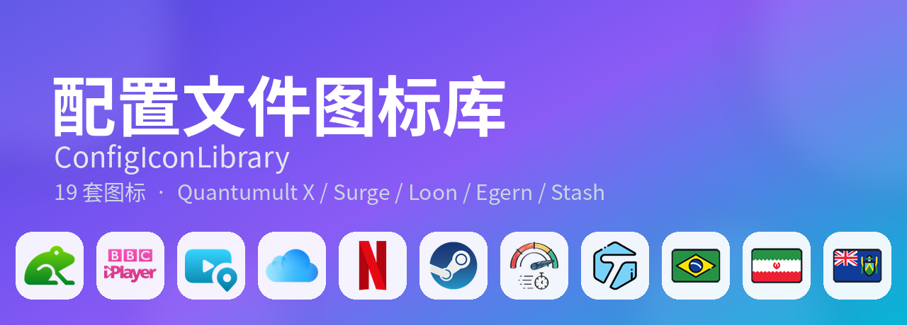

Proxy uygulamaları (Quantumult X, Surge, Loon, Egern, Stash vb.) için profil simgesi abonelik koleksiyonudur. Aşağıdaki simge seti adına tıklayın — bu, abonelik bağlantısıdır. Kopyalayıp proxy uygulamanızın simge aboneliğine ekleyin; profil, abonelik ve politika gruplarına ilgili simge setini uygulayabilirsiniz.

## 📊 İstatistikler

## 🛠️ Teknoloji Yığını

## 😄 Günün Sözü

## 🎮 Katkı Grafiği

<picture>
  <source media="(prefers-color-scheme: dark)" srcset="https://contrib-rotate.lzr52o.workers.dev/rotate?theme=dark" />
  <source media="(prefers-color-scheme: light)" srcset="https://contrib-rotate.lzr52o.workers.dev/rotate?theme=light" />
  
</picture>

## Tüm Simgeler Bir Bakışta

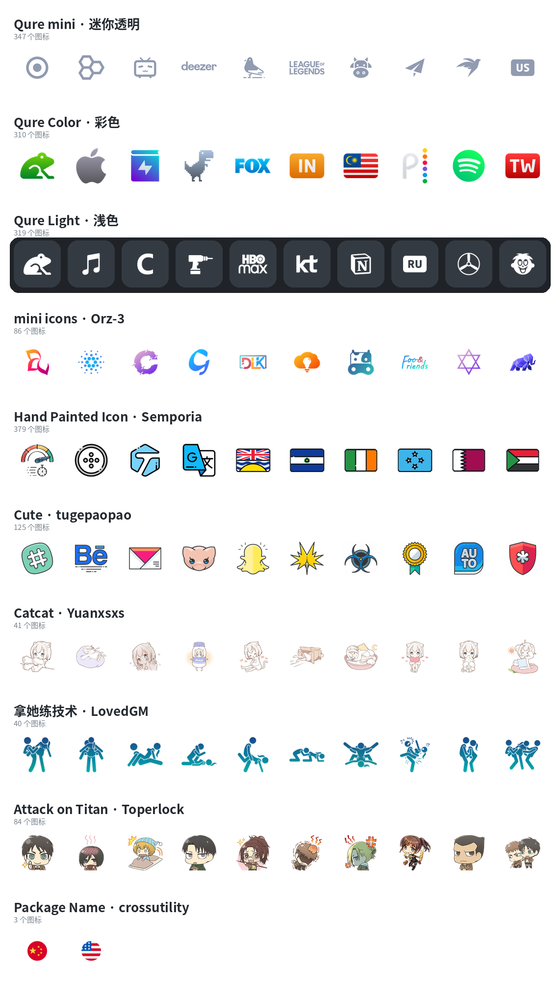

## Simge Listesi

### Qure Serisi (Yazar: Koolson)

| Simge Seti | Stil / Açıklama | Simge Sayısı |
|---|---|---|
| [Qure mini](https://raw.githubusercontent.com/lzr52o/ConfigIconLibrary/master/Quremini.json) | Mini şeffaf tema, abonelik simgeleri için ideal | 347 |
| [Qure Color（全部）](https://raw.githubusercontent.com/lzr52o/ConfigIconLibrary/master/QureColor-All.json) | Renkli tema · Tüm simgeler | 310 |
| [Qure Color（默认）](https://raw.githubusercontent.com/lzr52o/ConfigIconLibrary/master/QureColor-Default.json) | Renkli tema · Varsayılan | 15 |
| [Qure Color（常用）](https://raw.githubusercontent.com/lzr52o/ConfigIconLibrary/master/QureColor-Common.json) | Renkli tema · Sık kullanılanlar | 12 |
| [Qure Color（应用与游戏）](https://raw.githubusercontent.com/lzr52o/ConfigIconLibrary/master/QureColor-AppGame.json) | Renkli tema · Uygulamalar ve oyunlar | 41 |
| [Qure Color（服务）](https://raw.githubusercontent.com/lzr52o/ConfigIconLibrary/master/QureColor-Service.json) | Renkli tema · Hizmetler | 16 |
| [Qure Color（其它）](https://raw.githubusercontent.com/lzr52o/ConfigIconLibrary/master/QureColor-Other.json) | Renkli tema · Diğer | 47 |
| [Qure Color（地区）](https://raw.githubusercontent.com/lzr52o/ConfigIconLibrary/master/QureColor-Area.json) | Renkli tema · Bölgeler | 56 |
| [Qure Color（流媒体）](https://raw.githubusercontent.com/lzr52o/ConfigIconLibrary/master/QureColor-Media.json) | Renkli tema · Akış medyası | 99 |
| [Qure Color（服务器）](https://raw.githubusercontent.com/lzr52o/ConfigIconLibrary/master/QureColor-Server.json) | Renkli tema · Sunucular | 9 |
| [Qure Color（禁止）](https://raw.githubusercontent.com/lzr52o/ConfigIconLibrary/master/QureColor-Inhibition.json) | Renkli tema · Yasaklı | 4 |
| [Qure Light（全部）](https://raw.githubusercontent.com/lzr52o/ConfigIconLibrary/master/QureLight-All.json) | Açık tema · Tüm simgeler | 319 |

Orijinal adres:[Koolson/Qure](https://github.com/Koolson/Qure)

**Qure Önizleme**

| | |
|---|---|
| 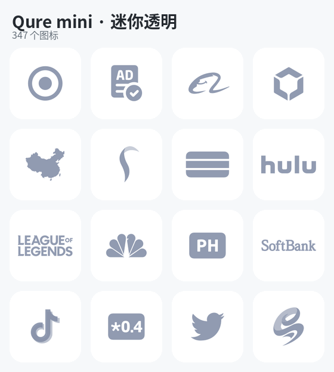 | 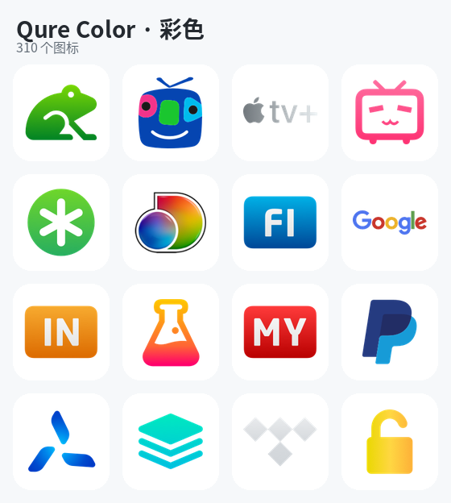 |
| 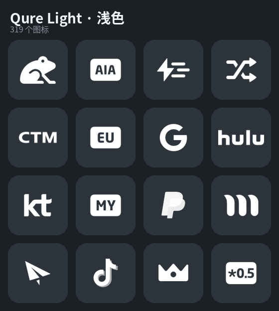 | |

### Diğer Yazarlar

| Simge Seti | Yazar | Stil / Açıklama | Simge Sayısı |
|---|---|---|---|
| [mini icons](https://raw.githubusercontent.com/lzr52o/ConfigIconLibrary/master/mini.json) | Orz-3 | Mini simgeler. Havalimanı abonelikleri, Task, bölge ve politika grubu simgeleri içerir | 86 |
| [Hand Painted Icon](https://raw.githubusercontent.com/lzr52o/ConfigIconLibrary/master/Semporia.json) | Semporia | El çizimi tarzı | 379 |
| [Cute](https://raw.githubusercontent.com/lzr52o/ConfigIconLibrary/master/Cute.json) | tugepaopao | Sevimli tarz, düzenli olarak güncelleniyor | 125 |
| [Catcat](https://raw.githubusercontent.com/lzr52o/ConfigIconLibrary/master/Catcat.json) | Yuanxsxs | Kedi teması | 41 |
| [拿她练技术](https://raw.githubusercontent.com/lzr52o/ConfigIconLibrary/master/zishi-cs.json) | LovedGM | Alıştırma çalışması | 40 |
| [Attack on Titan](https://raw.githubusercontent.com/lzr52o/ConfigIconLibrary/master/AOT-icons.json) | Toperlock | Attack on Titan teması | 84 |
| [Package Name](https://raw.githubusercontent.com/lzr52o/ConfigIconLibrary/master/icon-gallery.json) | crossutility | Örnek (yalnızca 3 simge) | 3 |

Orijinal adres:
- [Orz-3/mini](https://raw.githubusercontent.com/Orz-3/mini/master/mini.json)
- [Semporia/Hand-Painted-icon](https://raw.githubusercontent.com/Semporia/Hand-Painted-icon/master/Semporia.json)
- [tugepaopao/Image-Storage](https://raw.githubusercontent.com/tugepaopao/Image-Storage/master/other/Cute.json)
- [Yuanxsxs/QtumultX](https://raw.githubusercontent.com/Yuanxsxs/QtumultX/master/Icon/Catcat.json)
- [LovedGM/Quantumult-X-TuBiao](https://raw.githubusercontent.com/LovedGM/Quantumult-X-TuBiao/main/zishi-cs.json)
- [Toperlock/Quantumult](https://raw.githubusercontent.com/Toperlock/Quantumult/main/AOT-icons.json)
- [crossutility/Quantumult-X](https://raw.githubusercontent.com/crossutility/Quantumult-X/master/icon-gallery.json)

**Diğer Yazarların Önizlemesi**

| | |
|---|---|
| 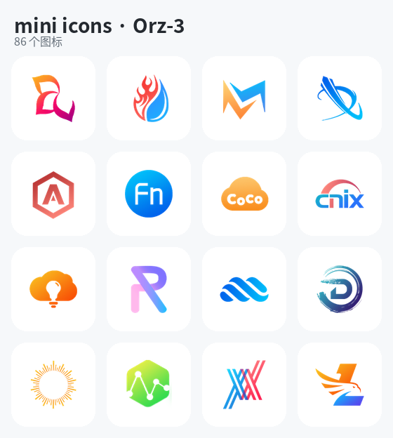 | 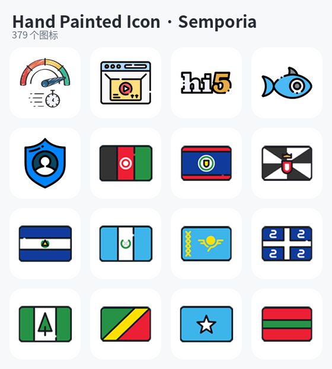 |
| 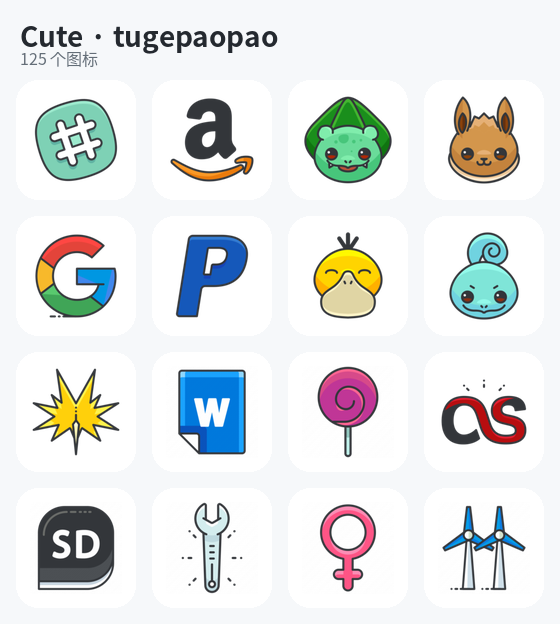 | 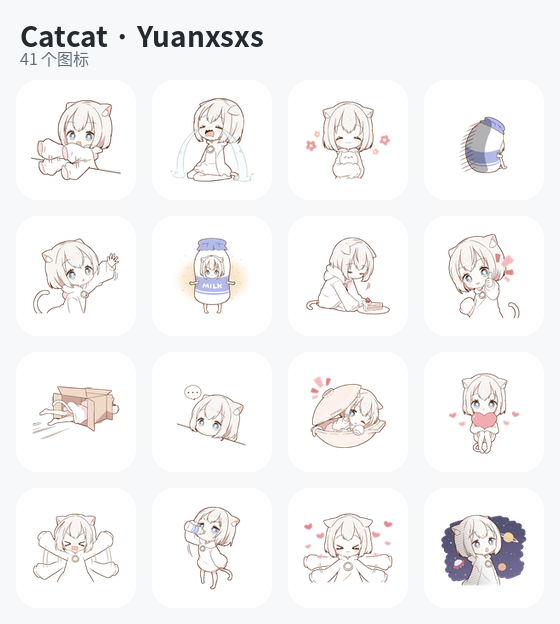 |
| 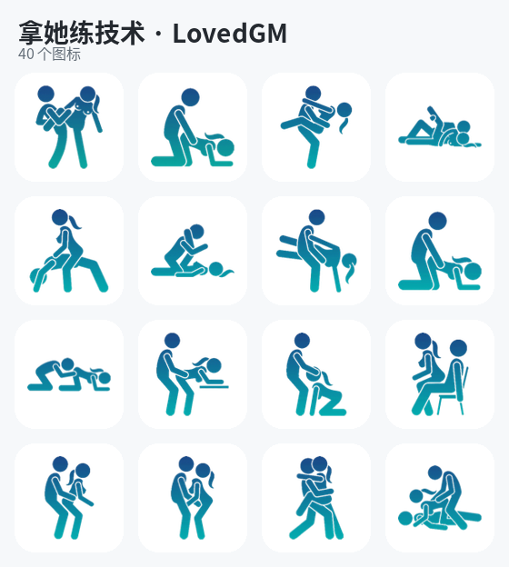 | 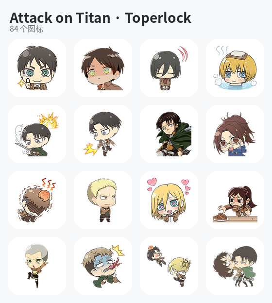 |
| 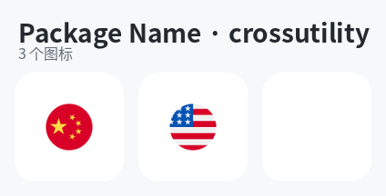 | |

## Kullanım Kılavuzu

### 1. Adım: Simge Kitaplığına Abone Olun

İstediğiniz simge setinin adına tıklayıp bağlantıyı kopyalayın (adın kendisi abonelik bağlantısıdır) ve proxy uygulamanızın simge aboneliğine (simge kitaplığı) ekleyin. Uygulama tüm seti indirecek ve simge değiştirirken doğrudan buradan seçim yapabileceksiniz.

- Quantumult X: abonelik bağlantısını simge abonelikleri bölümünden ekleyin.
- Loon: abonelik bağlantısını simge abonelikleri bölümünden ekleyin.
- Surge / Egern / Stash: abonelik bağlantısını simge abonelikleri veya simge kitaplığı girişinden ekleyin (girişin konumu uygulamaya göre biraz değişir, genellikle ayarlar veya profil ile ilgili sayfadadır).

### Profil Simgesini Değiştirme

Simge kitaplığına abone olduktan sonra uygulamada bir profili açın (veya üzerine uzun basın), simge alanında abone olduğunuz kitaplıklardan bir simge seçip kaydedin. Giriş noktası uygulamaya göre biraz değişir, ancak genellikle profilin ayarlarında veya uzun basma menüsündedir.

### Abonelik ve Politika Grubu Simgelerini Değiştirme

#### Quantumult X

**Abonelik simgeleri (metin düzenleme):** profil düzenleyiciyi açıp `[server_remote]` bölümünü bulun ve simge eklemek istediğiniz abonelik satırında `enabled=true` öncesine `img-url=<simge URL'si>` ekleyin. Öncesini ve sonrasını İngilizce virgüllerle ayırın ve virgülden sonra bir boşluk bırakın.

Tam örnek: `https://example.com/sub.txt, tag=<abonelik adı>, img-url=https://raw.githubusercontent.com/Koolson/Qure/master/IconSet/mini/Direct.png, enabled=true`

**Politika grubu simgeleri:**
- Arayüz: simgesini değiştirmek istediğiniz politika grubuna uzun basıp Düzenle'yi seçin ve simge alanına simge URL'sini girin.
- Metin düzenleme: profil düzenleyiciyi açıp `[policy]` bölümünü bulun ve değiştirmek istediğiniz politika bölümünde `enabled=true` öncesine `img-url=<simge URL'si>` ekleyin. Öncesini ve sonrasını İngilizce virgüllerle ayırın ve virgülden sonra bir boşluk bırakın.

#### Loon

**Arayüz:** alttaki "Politika" sekmesine dokunun, simgesini değiştirmek istediğiniz aboneliğe veya politika grubuna uzun basın ve simge alanına simge URL'sini girin.

**Metin düzenleme:** Yapılandırma sekmesini açıp Düzenle → Metin Düzenleme'ye dokunun, `[Remote Proxy]` / `[Proxy Group]` bölümünü bulun ve değiştirmek istediğiniz bölüme `img-url=<simge URL'si>` ekleyin. Önceki kısımdan İngilizce virgülle ayırın.

#### Surge / Egern / Stash

Bu kitaplığın bağlantısını simge aboneliklerine ekledikten sonra profil, abonelik veya politika grubunun simge ayarlarından kitaplıktan seçim yapmanız yeterlidir. Tam giriş noktası her uygulamanın güncel sürümüne bağlıdır.

### Tek Simge İçin Doğrudan Bağlantı (img-url)

Yalnızca tek bir simge kullanmak istiyorsanız tüm sete abone olmanız gerekmez — simgenin doğrudan PNG bağlantısını `img-url=` sonrasına yazmanız yeterlidir. Simge PNG adresleri genellikle orijinal yazarın deposundadır ve simge adından oluşturulur; örneğin Qure simgeleri `https://raw.githubusercontent.com/Koolson/Qure/master/Other/` dizinindedir. `name.png` yerine gerçek dosya adını yazmayı unutmayın.

## Sorumluluk Reddi

1. Bu kitaplıktaki simgeler ve LOGO'lar yalnızca kaynak paylaşımı ve öğrenme amaçlıdır. Bunların yasallığı, meşruiyeti ve doğruluğu garanti edilmez; bu kitaplığı hiçbir ticari amaçla veya kâr elde etmek için kullanmayın;
2. Güvenli liman ilkesine uygun olarak, herhangi bir görsel veya içerik telif hakkı ihlal ediyorsa lütfen Telegram özel sohbet botu [@ccccccccoBot](https://t.me/ccccccccoBot) ile iletişime geçerek bildirin. Doğrulandıktan sonra kaldırılacaktır. Tüm telif hakları orijinal yazarlara ve web sitelerine aittir;
3. Herhangi bir içerikten sorumlu değilim; buna içerikteki hatalardan kaynaklanan her türlü kayıp veya zarar dahildir, ancak bunlarla sınırlı değildir;
4. Bu web sitesine herhangi bir yolla giren veya bu kitaplığın ilgili kaynaklarını doğrudan ya da dolaylı olarak kullanan herkes bu beyanı dikkatle okumalıdır. Bu kitaplığın herhangi bir öğreticisini veya kaynağını kullanmanız ya da yeniden yayınlamanız durumunda bu sorumluluk reddini kabul etmiş sayılırsınız.
5. Yeniden yayınlarken lütfen kaynağı belirtin. Teşekkürler!

## Açıklamalar

- Toplam 19 profil simgesi seti vardır ve dosyaların tamamı bu deponun kök dizinindedir.
- Simge dosyaları her yazarın orijinal deposundan alınmıştır ve telif hakkı orijinal yazarlara aittir; bu kitaplık yalnızca abonelik için derlenmiştir.
- Orijinal `zishi-cs.json` dosyasının sonunda fazladan bir virgül vardı (geçersiz JSON). Burada düzeltilmiştir; simge içeriği değişmemiştir.

